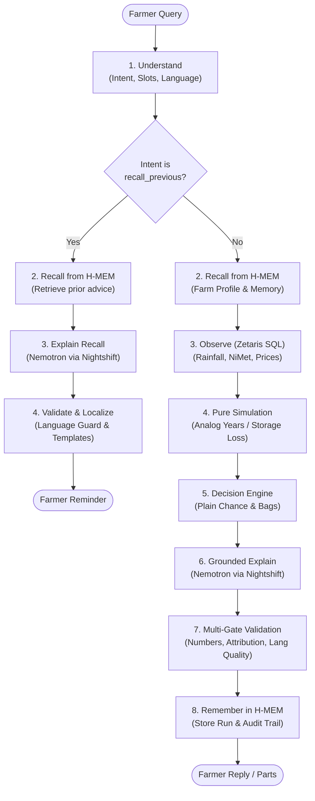

# Ikore AI

**Ìkórè** means *harvest* in Yoruba.

Ikore AI is an agronomic decision agent designed to empower Nigerian smallholder farmers in Oyo State (calibrated for Ogbomoso and Iseyin) with data-grounded guidance on maize planting dates, harvest selling-versus-storage timing, and general agronomic operations across the maize lifecycle. The agent provides plain-language explanations in English, Nigerian Pidgin, and Yoruba, strictly computing all probabilities and economic figures in deterministic code so that language models never calculate or alter figures shown to farmers.

- **Hackathon Track**: Track 3: Reasoning Architecture
- **Team**: ARAZAKA (Solo: Bonnke Olaitan)
- **Repository**: [https://github.com/olaxbonnke/ikore-ai](https://github.com/olaxbonnke/ikore-ai)
- **Languages Supported**: English (`en`), Yoruba (`yo`), Nigerian Pidgin (`pcm`)

---

## Architecture & Reasoning Pipeline

Ikore AI enforces a strict separation between perception, memory retrieval, federated data queries, deterministic simulation, multilingual explanation, multi-gate validation, and memory retention.

### Current Intents

1. **`plant_timing`**: Evaluates candidate planting windows (`plant_now`, `wait_7`, `wait_14`). When a farmer specifically asks whether current rainfall is sufficient to start planting (e.g. *"Is the rain enough to plant now?"* or *"Will this month's rain be enough?"*), the intent carries slot `focus: "rain_adequacy"`. In rain adequacy mode, the response leads with establishment rainfall adequacy metrics (median and range in mm across analog seasons) before giving the timing verdict.
2. **`sell_or_store`**: Evaluates whether to sell harvested grain immediately at an offered price or store for 4, 8, 12, or 24 weeks in PICS hermetic bags or plain sacks, calculating storage losses and historical seasonal price trends.
3. **`maize_agronomy`**: General operational guidance across the crop lifecycle (watering/irrigation, fertilizer application, weeding, pest control like fall armyworm, harvest maturity signs, and post-harvest drying/handling). This is explicitly labeled as *general guidance — not a data-checked decision*, runs under strict smallholder safety constraints (no chemical brand names or dosages; farmers are directed to local ADP extension officers), and uses recent 14-day rainfall queries on `oko_pg.rain_daily` for watering and harvest questions.
4. **`recall_previous`**: Fast-path reminder shortcut. Directly recalls prior advice from the farm's recorded H-MEM ledger (executing 0 Zetaris queries).
5. **`out_of_scope`**: Handles questions about non-maize crops (cassava, yam, rice) or non-farming matters with an honest, localized boundary notice.

### Compound Questions & `parts[]`

A single farmer message can contain multiple questions (for instance, asking when to plant *and* how to water maize, in English or Yoruba). When a compound question is received:
- The orchestrator decomposes the message into primary and secondary parts.
- The reply returns an array of `parts[]`, where each part provides:
  - `intent`: The specific intent of that section (`plant_timing`, `sell_or_store`, `maize_agronomy`, or `recall_previous`).
  - `kind`: `"decision"` (data-checked simulation and verdict) or `"guidance"` (operational agronomy advice).
  - `reply`: The localized text for that part.
  - `responded_model`: The model that generated the text (e.g. `nvidia/nemotron-3.5-lightning-30b-a3b`), or `"template"` if a fallback was used.
  - `fallback_used`: Boolean indicating whether the part fell back to deterministic templates.
  - `fallback_reason`: The exact reason if a fallback occurred (omitted or `undefined` when generated cleanly by the model).

### Memory Isolation for Guidance

Guidance parts (`maize_agronomy`) never receive past sell/store advice records or plant timing verdicts from H-MEM. Guidance memory is filtered through a strict whitelist that only admits farm profile facts (hectares, zone, state, soil condition, storage method). Numbers allowed in guidance are strictly constructed from these profile facts and the part's own data, preventing commercial figures or decision numbers from bleeding into operational field advice.

### Fallback Reasons & Language Quality

When an LLM completion fails validation, the system falls back safely to deterministic, curated templates. The fallback reasons are:
- **`template_by_design`**: Used when deterministic templates are selected intentionally (such as offline sample mode, or where code-generated output is preferred).
- **`no_previous_advice`**: Returned on `recall_previous` when H-MEM contains no prior recorded advice for that farm on the requested topic.
- **`grounding_failed`**: Triggered when guidance text contains ungrounded currency amounts (`₦`, `naira`, `NGN`, `kobo`), internal tokens (e.g. `store_4w`, `wait_7`), numbers not present in context, or cross-topic terminology (e.g. bag counts or buyer mentions in watering guidance).
- **`language_quality`**: Triggered when model-generated Yoruba contains English leaks (e.g. `finger`, `topsoil`, `water`, `soil`), repetitive text loops, or low tone mark / diacritic density (<40% of words containing Yoruba diacritics). Yoruba guidance is capped at a single model attempt: if the completion fails the language quality check, it immediately falls back to the curated, natural Yoruba template for that topic.

### The 8-Step Decision Pipeline

1. **Understand**: Parses user message into intent, slots, and language using deterministic rules and NVIDIA Nemotron via Meterless Nightshift.
2. **Recall (H-MEM)**: Queries per-farm memory in Meterless H-MEM for farm profile facts and prior records.
3. **Observe (Zetaris)**: Executes federated, read-only SQL queries via Zetaris `DataGateway` across daily rainfall history (`rain_daily`), seasonal onset benchmarks (`nimet_onset`), and wholesale market prices. For watering/harvest agronomy questions, queries recent 14-day rainfall.
4. **Simulate**: Deterministic agronomic simulations:
   - *Planting*: Analog-year rainfall weighting and false-start seedling mortality simulation (`simulatePlanting`).
   - *Selling*: Post-harvest storage loss curves and detrended WFP market price seasonality (`simulateSelling`).
5. **Decide**: Evaluates candidate options (`plant_now`, `wait_7`, `wait_14` or `sell_now`, `store_4w`, `store_8w`, `store_12w`, `store_24w`), scoring each option and expressing risks as plain chance phrases (e.g., "about 1 in 7 seasons", "almost never"). (For `maize_agronomy`, `decision` is `null` with `guidance_type: "general"`).
6. **Explain**: Generates a natural language explanation in the requested language using NVIDIA Nemotron through Meterless Nightshift (or verified templates).
7. **Validate**: Multi-gate validator enforces output structure (≤12-word headline, ≤2-sentence reason, zero raw percentages, no ISO dates), verifies number grounding and option attribution, checks for chemical product names or dosage patterns, and enforces language quality.
8. **Remember (H-MEM)**: Persists the question, recommendation, and key numbers into the farm's H-MEM memory store with run-level deduplication.

### Reasoning Pipeline Diagram



---

## Sponsor Technology

### 1. Zetaris (Federated Data Layer)
- **Code locations**: `src/data/gateway.ts`, `src/data/queries.ts`, `scripts/zetaris-load.ts`, `scripts/zetaris-verify.ts`, `zetaris/sql/*.sql`.
- **Role**: Provides federated SQL query access over the `oko_pg` catalog (`rain_daily`, `nimet_onset`, and price tables), executed read-only per run via `DataGateway` (`ZetarisGateway` in live mode, `SnapshotGateway` in snapshot mode).
- **How to verify**:
  - In `/api/run` responses, inspect `zetaris.queries_run` and `zetaris.row_counts` (e.g. 12,899 rows for `rain_daily`, 1 row for `nimet_onset`, 312 rows for `prices`).
  - In execution traces (`logs/trace-<run_id>.jsonl`), see step `observe` with component `zetaris`.
  - Run `npm run zetaris:verify` to check table row counts against the active engine.

### 2. Meterless H-MEM (Per-Farm Long-Term Memory)
- **Code locations**: `src/memory/hmem.ts`, `src/engine.ts`, `scripts/hmem-seed.ts`, `vendor/hmem/` (vendored Apache-2.0 reference engine).
- **Role**: Maintains persistent, per-farm memory stores with trust ledgers. Recalls farm context prior to decision simulation, records each question and advice run with unique deduplication IDs, and directly answers "remind me" inquiries from memory.
- **How to verify**:
  - In `/api/run` responses, check `memory.hmem_used: true`, `memory.recalled` (listing retrieved memories), and `memory.stored: "mem-<id>"`.
  - In execution traces, see step `recall` and step `remember` with component `hmem`.
  - Test recall queries to verify that `memory.hmem_used` is true while `zetaris.queries_run` is empty (`[]`).

### 3. Meterless Nightshift (Primary AI Provider)
- **Code locations**: `src/core/nightshift.ts`, `src/llm/provider.ts`, `src/core/llm.ts`, `scripts/nightshift-models.ts`, `scripts/nightshift-smoke.ts`.
- **Role**: Acts as the primary AI provider exposing an OpenAI-compatible desktop service at `METERLESS_BASE_URL`. All LLM calls route through Nightshift with bearer token `METERLESS_RUNTIME_TOKEN` and header `meterless-app: ikore-ai`. No provider API keys exist in application code.
- **How to verify**:
  - In `/api/run` responses, check `llm.provider: "nightshift"`.
  - In execution traces, see steps `understand` and `explain` with component `nightshift`.
  - Run `npx tsx scripts/nightshift-smoke.ts` to test an isolated request and verify model headers.

### 4. NVIDIA Nemotron (Language & Explanation Model)
- **Code locations**: `src/llm/understand.ts`, `src/llm/explain.ts`, `src/llm/agronomy.ts`, `prompts/understand.md`, `prompts/explain.md`, `prompts/agronomy.md`.
- **Model**: `nvidia/nemotron-3.5-lightning-30b-a3b`.
- **Role**: Parses unstructured farmer queries into typed intents and slots, and writes concise explanations in English, Yoruba, and Nigerian Pidgin. Crucially, requests pass `chat_template_kwargs: { enable_thinking: false }` to disable reasoning tokens and prevent response truncation.
- **How to verify**:
  - In `/api/run` responses, check `llm.requested_model: "nvidia/nemotron-3.5-lightning-30b-a3b"` and `llm.responded_model`.
  - Inspect `responded_model` on individual parts in compound replies.

---

## Quick Start

### Option A: Offline / Sample Mode (Zero Credentials, Immediate)
Sample mode runs 100% offline using bundled snapshots, seeded farm profiles, and deterministic templates. No external database, no Nightshift, and no API keys are required:

```bash
git clone https://github.com/olaxbonnke/ikore-ai.git
cd ikore-ai
npm install
npm run demo
```
This seeds demo farm memories into `.oko/hmem` and starts the Next.js server at `http://localhost:3000`.

### Option B: Live Mode (Zetaris + Nightshift + Nemotron)
To run live queries and live LLM generations:

1. **Zetaris**: Ensure the Zetaris engine is running with catalog `oko_pg` accessible at `ZETARIS_REST_URL`.
2. **Meterless Nightshift**: Start the local Nightshift desktop application (defaulting to `http://127.0.0.1:8088/v1`) with NVIDIA credentials configured.
3. **Environment Configuration**: Configure `.env`:
   ```bash
   DATA_MODE=live
   ZETARIS_REST_URL=http://localhost:8888
   ZETARIS_API_KEY=
   ZETARIS_ORG_ID=
   METERLESS_BASE_URL=http://127.0.0.1:8088/v1
   METERLESS_RUNTIME_TOKEN=
   METERLESS_MODEL=nvidia/nemotron-3.5-lightning-30b-a3b
   METERLESS_APP=ikore-ai
   SAMPLE_MODE=false
   ```
4. **Start the Application**:
   ```bash
   npm run dev
   ```

---

## Live System Output Examples

The following are untruncated outputs from actual live runs connected to Zetaris and Meterless Nightshift (`nvidia/nemotron-3.5-lightning-30b-a3b`). Live runs write execution traces to `logs/`, which is gitignored and not committed to the repository; the four sample traces below are real runs recorded on 27 October 2026 and committed under `samples/traces/` for audit and inspection:

### 1. English Compound Query: Planting Decision + Watering Guidance
- **Trace**: [`samples/traces/trace-run_1793069788246_mz596.jsonl`](samples/traces/trace-run_1793069788246_mz596.jsonl)
- **Question**: `"when do i start planting and how should i wet my maize"`
- **Farm**: Mama Bisi (`farm_bisi_ogbomoso`) | **Language**: `en`
- **Elapsed Time**: 7.24s | **Status**: 200 OK
- **Zetaris Rows**: `rain_daily`: 12,899, `nimet_onset`: 1

**Full Reply**:
```text
Wait a week. Plant around 17 April.

If you plant now, about 1 in 7 seasons needed replanting. If you wait a week, it almost never happened in 35 past seasons.

• 35 past seasons evaluated

On watering:
Check the topsoil with your finger. If it feels dry, give water at the base of the plants in the early morning or evening. Do not water so much that the soil becomes soggy. If rain falls, stop watering.
```

**Parts Breakdown**:
- **Part 1**: `intent`: `plant_timing` | `kind`: `decision` | `responded_model`: `nvidia/nemotron-3.5-lightning-30b-a3b` | `fallback_used`: `false`
- **Part 2**: `intent`: `maize_agronomy` (topic: `watering`) | `kind`: `guidance` | `responded_model`: `nvidia/nemotron-3.5-lightning-30b-a3b` | `fallback_used`: `false`

---

### 2. Yoruba Compound Query: Planting Decision + Watering Guidance
- **Trace**: [`samples/traces/trace-run_1793070596526_wvquc.jsonl`](samples/traces/trace-run_1793070596526_wvquc.jsonl)
- **Question**: `"Ìgbà wo ni kí n gbìn àgbàdo mi, báwo sì ni kí n bomi rin ín?"`
- **Farm**: Mama Bisi (`farm_bisi_ogbomoso`) | **Language**: `yo`
- **Elapsed Time**: 18.13s | **Status**: 200 OK
- **Zetaris Rows**: `rain_daily`: 12,899, `nimet_onset`: 1

**Full Reply**:
```text
Dúró ọ̀sẹ̀ kan. Gbìn ní nǹkan bí Ọjọ́ Ẹtì, 17 Oṣù Kẹrin.

Tí o bá gbìn báyìí, ewu láti tún gbìn jẹ́ ẹ̀ẹ̀kan nínú àsìkò méje. Tí o bá dúró ọ̀sẹ̀ kan, fẹ́rẹ́ kò ṣẹlẹ̀ rárá nínú àsìkò 35 sẹ́yìn.

• A wo àkọsílẹ̀ ọdún 35 sẹ́yìn

Nípa bíbomi rin àgbàdo:
Àgbàdo tí a gbìn sínú òjò gbẹ́kẹ̀le òjò lásán. Ṣàyẹ̀wò ilẹ̀ kí o rí i dájú pé ó tutù tó ìwọ̀n ìka ọwọ́ kan. Tí ọ̀dá bá wà lẹ́yìn gbígbìn, bomi rin ìdí àgbàdo ní kùtùkùtù òwúrọ̀ tàbí ìrọ̀lẹ́ kí o sì yẹra fún àkúnya omi. Kàn sí alábòójútó iṣẹ́ àgbẹ̀ (ADP) lábúlé rẹ fún ìtọ́sọ́nà síwájú.
```

**Parts Breakdown**:
- **Part 1**: `intent`: `plant_timing` | `kind`: `decision` | `responded_model`: `nvidia/nemotron-3.5-lightning-30b-a3b` | `fallback_used`: `false`
- **Part 2**: `intent`: `maize_agronomy` (topic: `watering`) | `kind`: `guidance` | `responded_model`: `template` | `fallback_used`: `true` | `fallback_reason`: `"language_quality"`
*(Note: As documented, Nemotron's uncurated Yoruba failed the language-quality validator due to English word leaks and loops, and immediately fell back to the safe, natural curated template).*

---

### 3. Sell or Store Decision: Farm Ade Iseyin
- **Trace**: [`samples/traces/trace-run_1793066866740_x0u5s.jsonl`](samples/traces/trace-run_1793066866740_x0u5s.jsonl)
- **Question**: `"I have 20 bags of maize and a buyer is offering N45,000 per bag. Should I sell now or store?"`
- **Farm**: Baba Ade (`farm_ade_iseyin`) | **Language**: `en`
- **Elapsed Time**: 4.21s | **Status**: 200 OK
- **Zetaris Rows**: `prices`: 312

**Full Reply**:
```text
Store your maize for 8 weeks.

In 8 of 8 past years, storing eight weeks earned more than selling now. Storage loss in PICS bags is less than a tenth of a bag out of your 20.

• Prices historically rose enough to cover storage
```

**Decision Figures (Computed Deterministically)**:
- **Sell-now value**: ₦900,000 (20 bags @ ₦45,000/bag)
- **Expected value after storage (store_8w)**: ₦963,407 (~₦48,170/bag net of storage costs)
- **Storage loss in PICS bags**: 0.06 bags (*"less than a tenth of a bag out of your 20"*)

**Parts Breakdown**:
- **Part 1**: `intent`: `sell_or_store` | `kind`: `decision` | `responded_model`: `nvidia/nemotron-3.5-lightning-30b-a3b` | `fallback_used`: `false`

---

### 4. Memory Recall Query: Fast-Path Reminder
- **Trace**: [`samples/traces/trace-run_1793069330337_b8ibk.jsonl`](samples/traces/trace-run_1793069330337_b8ibk.jsonl)
- **Question**: `"Remind me what you told me about selling my maize"`
- **Farm**: Mama Bisi (`farm_bisi_ogbomoso`) | **Language**: `en`
- **Elapsed Time**: 3.37s | **Status**: 200 OK
- **Zetaris Queries Run**: `[]` (0 queries — answered directly from H-MEM)

**Full Reply**:
```text
On 10 April I told you to store your maize for 4 weeks. The buyer offered ₦45,000 per bag, with an expected return of ₦920,220.
```

**Parts Breakdown**:
- **Part 1**: `intent`: `recall_previous` | `kind`: `guidance` | `responded_model`: `nvidia/nemotron-3.5-lightning-30b-a3b` | `fallback_used`: `false`

---

## Judge API & Inspection

In addition to the web interface at `/`, Ikore AI exposes a JSON REST API for automated judge evaluation without requiring UI interaction:

### 1. `GET /api/health`
Checks system health and verifies whether live providers are configured:
```bash
curl http://localhost:3000/api/health
```

**Response Example**:
```json
{
  "ok": true,
  "sample_mode": false,
  "nightshift_configured": true,
  "zetaris_configured": true
}
```

### 2. `POST /api/run`
Executes the reasoning orchestrator end-to-end.

**Request Body**:
- `question` (string, required): Farmer's query.
- `farm_id` (string, optional, default: `"farm_bisi_ogbomoso"`). Known valid farm IDs from `data/farms_seed.csv`:
  - `"farm_bisi_ogbomoso"`: Mama Bisi (2 ha in Ogbomoso North, Oyo; sack storage).
  - `"farm_ade_iseyin"`: Baba Ade (1.5 ha in Iseyin, Oyo; PICS bags).
  If an unknown `farm_id` is passed (e.g. `"F001"`), the endpoint returns HTTP 400 Bad Request with `component: "input"`, the list of `valid_farm_ids`, and writes an execution trace.
- `lang` (`"en"` | `"yo"` | `"pcm"`, optional, auto-detected if omitted).
- `asOf` (string, optional, ISO date e.g. `"2026-04-10"`).

**cURL**:
```bash
curl -X POST http://localhost:3000/api/run \
  -H "Content-Type: application/json" \
  -d '{"question":"When should I plant my maize this season?","farm_id":"farm_bisi_ogbomoso","lang":"en"}'
```

---

## Testing & Quality Assurance

Ikore AI enforces comprehensive unit and integration test coverage across simulations, memory layers, database gateways, API routes, and multilingual validators:

```bash
npm test             # Runs all 193 Vitest tests across 13 test files
npx tsc --noEmit     # Validates TypeScript compilation with zero errors
```

- **Test Suites (13 files)**:
  - `tests/agronomy.test.ts`: Maize agronomy guidance, unit-aware grounding, topic restrictions, and language quality checks.
  - `tests/api-run.test.ts`: End-to-end `/api/run` and `/api/health` endpoints, compound outputs, and recall shortcuts.
  - `tests/compound-and-grammar.test.ts`: Multi-part compound queries, punctuation hygiene, and multilingual ordering.
  - `tests/decide.test.ts`: Risk scoring, plain-chance phrase mapping, and tie-breaking mechanics.
  - `tests/evidence-view.test.ts`: Farmer evidence panel data structures and attribution badges.
  - `tests/explain-validator.test.ts`: Output structure rules, number attribution, and language constraints.
  - `tests/gateway.test.ts`: DataGateway fallback logic and snapshot data integrity.
  - `tests/hmem.test.ts`: Farm memory initialization, querying, deduplication, and trust ledgers.
  - `tests/nightshift.test.ts`: Meterless Nightshift HTTP provider, headers, and model fallback.
  - `tests/planting.test.ts`: Analog-year weighting and seedling establishment rain simulation.
  - `tests/selling.test.ts`: Storage loss curves, monthly price seasonality, and commercial decision logic.
  - `tests/smoke.test.ts`: Smoke checks for configuration and runtime health.
  - `tests/stats.test.ts`: Moving averages, percentiles, and statistical distribution helpers.
- **Test Count**: 193 passing tests.

---

## Honest Limitations

1. **Geographic Scope**: The agronomic models, planting dates, and weather baseline are calibrated exclusively for **Oyo State** (Ogbomoso and Iseyin in the derived savanna zone). Parameters are not calibrated for northern Sudan/Sahel zones or south-eastern rainforest zones.
2. **Synthetic Farm Profiles**: Farm profile details (`data/farms_seed.csv`) and seasonal farm logs (`data/farm_records.csv`) are synthetic demo records used to seed H-MEM for evaluation. They are explicitly tagged in memory as `[Demo profile from data/farms_seed.csv]` and `[Demo record from data/farm_records.csv]`.
3. **Data Gaps & Sources**:
   - *Precipitation*: NASA POWER daily precipitation records experience satellite telemetry lag and occasional gaps; 16-day forecasts rely on Open-Meteo. A 200 mm spike guard (`MAX_DAILY_RAIN_MM`) is enforced to prevent sensor artifacts from distorting seedling mortality simulations.
   - *Market Prices*: Based on UN WFP monthly wholesale maize prices for Bodija Market in Ibadan. Daily price movements between monthly observations are linearly interpolated, and seasonality curves are detrended using a 12-month centred moving average (CMA).
   - *Nominal Currency*: Storage economics and price comparisons are expressed in nominal Nigerian Naira (₦) and do not account for general consumer price index (CPI) inflation.
4. **Yoruba Linguistic Validation**: Yoruba prompts, tone marks, and responses follow standard orthography and automated checks. When live models generate contaminated or looping Yoruba, the agent automatically falls back to curated Yoruba templates to guarantee grammatical correctness and farmer safety.
5. **Nightshift Dependency in Live Mode**: Live mode requires a running local instance of the Meterless Nightshift desktop application with NVIDIA credentials. If Nightshift is unavailable, the agent automatically falls back to deterministic pre-verified templates.

---

## Pre-Existing Work Declaration

In accordance with the hackathon cutoff (**2026-10-22T00:00:00Z**), the following work existed prior to the build window:

1. **Specification & Documentation Pack (Prepared 2026-10-21)**:
   - Initial specification docs: `PROJECT.md`, `DESIGN.md`, `DATA.md`, `INSTRUCTIONS.md`, `AGENTS.md`.
   - Cursor guidance rules: `.cursor/rules/oko.mdc`.
   - Seed datasets: `data/crop_calendar_maize_ng.csv`, `data/farms_seed.csv`, `data/storage_loss.csv`.
2. **Meterless Starter Scaffold (Apache-2.0, Third-Party)**:
   - Base repository scaffold from `agentathon-starter` (`.gitignore`, `images/notebook-loop.svg`, `notebook.ts`, `seed/example-session.txt`, initial stub files).
3. **Vendored Reference Engine (Apache-2.0, Third-Party)**:
   - `@meterless/hmem-reference` located in `vendor/hmem/` providing underlying memory mining, retrieval, and ledger mechanics.

**Built During the Hackathon Event Window**:
All subsequent code—including the pure simulation engines (`simulatePlanting`, `simulateSelling`), the Zetaris `DataGateway` and SQL queries, H-MEM farm integration and deduplication, Meterless Nightshift provider client, NVIDIA Nemotron prompt pipelines, compound query orchestration and parts decomposition, multilingual number and language-quality validators, REST judge API, JSONL run tracer, and the entire 193-test automated test suite—was developed from scratch during the hackathon.

---

## AI Tools Declaration

This codebase was developed using AI coding assistants (initially Cursor, followed by Google Antigravity). All architectural decisions, mathematical formulas, data integration contracts, and code changes were directed, reviewed, audited, and tested by the author (Bonnke Olaitan).

---

## Licence

Licensed under Apache-2.0. See [LICENSE](LICENSE) and [NOTICE](NOTICE). Third-party vendored code in `vendor/hmem/` retains its original Apache-2.0 licence.
