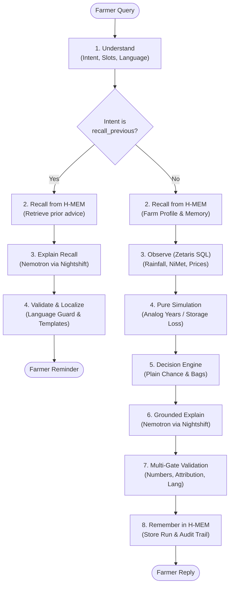

# Ikore AI

**Ìkórè** means *harvest* in Yoruba.

Ikore AI is an agronomic decision agent designed to empower Nigerian smallholder farmers in Oyo State (calibrated for Ogbomoso and Iseyin) with data-grounded guidance on maize planting dates, harvest selling-versus-storage timing, and general agronomic operations across the maize lifecycle. The agent provides plain-language explanations in English, Nigerian Pidgin, and Yoruba, strictly computing all probabilities and economic figures in deterministic code so that language models never calculate or alter figures shown to farmers.

- **Hackathon Track**: Track 3: Reasoning Architecture
- **Team**: ARAZAKA (Solo: Bonnke Olaitan)
- **Repository**: [https://github.com/olaxbonnke/ikore-ai](https://github.com/olaxbonnke/ikore-ai)
- **Languages Supported**: English (`en`), Yoruba (`yo`), Nigerian Pidgin (`pcm`)

---

## Architecture & Reasoning Pipeline

Ikore AI enforces a strict separation between perception, memory retrieval, federated data queries, deterministic simulation, multilingual explanation, multi-gate validation, and memory retention.

### The 8-Step Decision Pipeline

1. **Understand**: Parses user message into intent (`plant_timing`, `sell_or_store`, `maize_agronomy`, `recall_previous`), slots (bags, offer price, `focus: "rain_adequacy"`), and language using deterministic rules and NVIDIA Nemotron via Meterless Nightshift. Questions about non-maize crops (cassava, yam, rice) are identified as `out_of_scope`.
2. **Recall (H-MEM)**: Queries per-farm long-term memory in Meterless H-MEM for past farm profile facts, historical records, and previous advice.
3. **Observe (Zetaris)**: Executes federated, read-only SQL queries via Zetaris `DataGateway` across 35+ years of daily climate history (`rain_daily`), seasonal agro-meteorological onset benchmarks (`nimet_onset`), and wholesale market prices. For watering/irrigation and harvest/drying agronomy questions, queries recent 14-day rainfall.
4. **Simulate**: Pure deterministic agronomic simulations:
   - *Planting*: Analog-year rainfall weighting and false-start seedling mortality simulation (`simulatePlanting`).
   - *Selling*: Post-harvest storage loss curves and detrended WFP market price seasonality (`simulateSelling`).
5. **Decide**: Evaluates candidate options (`plant_now`, `wait_7`, `wait_14` or `sell_now`, `store_4w`, `store_12w`), scoring each option and expressing risks as farmer-friendly plain chance phrases (e.g., "almost never", "about 1 in 7 seasons") and bag counts. (For `maize_agronomy`, `decision` is `null` with `guidance_type: "general"`).
6. **Explain**: Generates a natural language explanation in the requested language using NVIDIA Nemotron through Meterless Nightshift (or verified deterministic templates). For rain adequacy queries, leads directly with establishment rainfall adequacy based on historical analog seasons (median and range in mm) before stating the recommended planting date.
7. **Validate**: Multi-gate validator enforces output structure (≤12-word headline, ≤2-sentence reason, zero percentages, no ISO dates), validates that numbers exist in context, checks that numbers are attached only to the option they describe, rejects prohibited chemical product names or dosage patterns, and checks Yoruba tone marks or Pidgin phrasing.
8. **Remember (H-MEM)**: Persists the question, recommendation, and key numbers into the farm's H-MEM memory store with run-level deduplication.

### The `maize_agronomy` General Guidance Path

Covers all operational maize queries outside planting timing and commercial sell/store trade decisions: watering/irrigation, land preparation, seed spacing and planting depth, fertiliser timing, weeding, pests and diseases (fall armyworm, stem borers), harvest signs of maturity, drying, and storage handling.
- Recalls farm profile & past advice from H-MEM.
- For watering or harvest queries, runs a real Zetaris SQL query on `oko_pg.rain_daily` for the past 14 days of rainfall.
- Explains via Nemotron under strict smallholder safety constraints: context numbers only, zero chemical dosage formulas or brand names (strictly refers farmers to local ADP extension officers), labeled with `"General guidance — not a data-checked decision"`.
- Records Q&A in H-MEM with run-level deduplication.

### The `recall_previous` Shortcut

When a farmer asks to be reminded of previous advice (e.g. *"Remind me, when did you say I should plant?"*, *"Kí lo sọ fún mi nípa ìgbà tí màá gbìn?"*, or *"Wetin you tell me about planting earlier?"*), the pipeline executes a dedicated shortcut:

`understand` &rarr; `recall` (H-MEM) &rarr; `explain` (Nemotron via Nightshift) &rarr; `validate`

It completely bypasses `observe` (executing 0 Zetaris queries), `simulate`, `decide`, and `remember`, directly answering from the farm's recorded H-MEM ledger.

### Reasoning Pipeline Diagram



---

## Sponsor Technology

### 1. Zetaris (Federated Data Layer)
- **Code locations**: `src/data/gateway.ts`, `src/data/queries.ts`, `scripts/zetaris-load.ts`, `scripts/zetaris-verify.ts`, `zetaris/sql/*.sql`.
- **Role**: Provides federated SQL query access over the `oko_pg` catalog (`rain_daily`, `nimet_onset`, and price tables), executed read-only per run via `DataGateway` (`ZetarisGateway` in live mode, `SnapshotGateway` in snapshot mode).
- **How to verify**:
  - In `/api/run` responses, inspect `zetaris.queries_run` and `zetaris.row_counts` (e.g. 12,899 rows for `rain_daily`, 1 row for `nimet_onset`).
  - In execution traces (`logs/trace-<run_id>.jsonl`), see step `observe` with component `zetaris`.
  - Run `npm run zetaris:verify` to check connectivity to the engine.

### 2. Meterless H-MEM (Per-Farm Long-Term Memory)
- **Code locations**: `src/memory/hmem.ts`, `src/engine.ts`, `scripts/hmem-seed.ts`, `vendor/hmem/` (vendored Apache-2.0 reference engine).
- **Role**: Maintains persistent, per-farm memory stores with trust ledgers. Recalls farm context prior to decision simulation, records each question and advice run with unique deduplication IDs, and directly answers "remind me" inquiries from memory.
- **How to verify**:
  - In `/api/run` responses, check `memory.hmem_used: true`, `memory.recalled` (listing retrieved memories), and `memory.stored: "mem-<id>"`.
  - In execution traces, see step `recall` and step `remember` with component `hmem`.
  - Test recall queries to verify that `memory.hmem_used` is true while `zetaris.queries_run` is empty (`[]`).

### 3. Meterless Nightshift (Primary AI Provider)
- **Code locations**: `src/core/nightshift.ts`, `src/llm/provider.ts`, `src/core/llm.ts`, `scripts/nightshift-models.ts`, `scripts/nightshift-smoke.ts`.
- **Role**: Acts as the primary AI provider exposing an OpenAI-compatible desktop service at `METERLESS_BASE_URL`. All LLM calls route through Nightshift with bearer token `METERLESS_RUNTIME_TOKEN` and header `meterless-app: ikore-ai`. No NVIDIA keys exist in the application code.
- **How to verify**:
  - In `/api/run` responses, check `llm.provider: "nightshift"`.
  - In execution traces, see steps `understand` and `explain` with component `nightshift`.
  - Run `npx tsx scripts/nightshift-smoke.ts` to test an isolated request and verify model headers.

### 4. NVIDIA Nemotron (Language & Explanation Model)
- **Code locations**: `src/llm/understand.ts`, `src/llm/explain.ts`, `prompts/understand.md`, `prompts/explain.md`.
- **Model**: `nvidia/nemotron-3.5-lightning-30b-a3b`.
- **Role**: Parses unstructured farmer queries into typed intents and slots, and writes concise, farmer-facing explanations in English, Yoruba, and Nigerian Pidgin. Crucially, requests pass `chat_template_kwargs: { enable_thinking: false }` to disable reasoning tokens and prevent response truncation.
- **How to verify**:
  - In `/api/run` responses, check `llm.requested_model: "nvidia/nemotron-3.5-lightning-30b-a3b"` and `llm.responded_model`.
  - In `decision.evidence`, verify the audit entry `[ev_explanation_model]` attributing the text to the responded model.

---

## Quick Start

### Option A: Offline / Sample Mode (Zero Credentials, Immediate)
Sample mode runs 100% offline using bundled snapshots, seeded farm profiles, and deterministic templates. No Docker, no Nightshift, and no API keys are required:

```bash
git clone https://github.com/olaxbonnke/ikore-ai.git
cd ikore-ai
npm install
npm run demo
```
This seeds demo farm memories into `.oko/hmem` and starts the Next.js server at `http://localhost:3000`.

### Option B: Live Mode (Zetaris + Nightshift + Nemotron)
To run live queries and live LLM generations:

1. **Zetaris**: Run the PostgreSQL container with ingested data (`npm run zetaris:load`) and launch the Zetaris engine. During hackathon development, Zetaris was hosted in a remote Docker environment (GitHub Codespace) and tunneled locally via SSH:
   ```bash
   ssh -N -L 8000:localhost:8000 <remote-host>
   ```
2. **Meterless Nightshift**: Start the local Nightshift desktop application (defaulting to `http://127.0.0.1:8088/v1`). Under the **Providers** tab in Nightshift, configure the NVIDIA provider and enter your NVIDIA API key.
3. **Environment Configuration**: Configure `.env` (blank keys shown for safety):
   ```bash
   DATA_MODE=live
   ZETARIS_REST_URL=http://localhost:8000
   ZETARIS_API_KEY=
   ZETARIS_ORG_ID=
   METERLESS_BASE_URL=http://127.0.0.1:8088/v1
   METERLESS_RUNTIME_TOKEN=
   METERLESS_MODEL=nvidia/nemotron-3.5-lightning-30b-a3b
   METERLESS_APP=ikore-ai
   SAMPLE_MODE=false
   ```
4. **Start the Application**:
   ```bash
   npm run dev
   ```
   *Port Note*: The application listens on port 3000 (`http://localhost:3000`).

### Web Interface
Once the server is running, open `http://localhost:3000` (or your configured port) in any browser to access the visual chat interface:
- **Farm Profile Selector**: Choose between Mama Bisi (Ogbomoso North) and Baba Ade (Iseyin).
- **Interactive Question Box**: Ask custom questions or select example chips for English planting advice, Yoruba planting advice, or memory recall.
- **Evidence & Grounding Panel**: Expand the collapsible panel to inspect compared options, replant risk percentages, median establishment rainfall, actual Zetaris SQL queries run, H-MEM memory recall/store details, and Nemotron model telemetry returned directly from `/api/run`.

---

## Judge API & Inspection

In addition to the web interface at `/`, Ikore AI exposes a JSON REST API for automated judge evaluation without requiring UI interaction:

### 1. `GET /api/health`
Checks system health and verifies whether live providers are configured (without exposing secrets).

**cURL**:
```bash
curl http://localhost:3000/api/health
```

**PowerShell**:
```powershell
Invoke-RestMethod -Uri "http://localhost:3000/api/health" -Method Get | ConvertTo-Json
```

**Response Example**:
```json
{
  "ok": true,
  "sample_mode": true,
  "nightshift_configured": false,
  "zetaris_configured": false
}
```

### 2. `POST /api/run`
Executes the reasoning orchestrator end-to-end.

**Request Body**:
- `question` (string, required): Farmer's query.
- `farm_id` (string, optional, default: `"farm_bisi_ogbomoso"`). Known valid farm IDs from `data/farms_seed.csv`:
  - `"farm_bisi_ogbomoso"`: Mama Bisi (2 ha in Ogbomoso North, Oyo; sack storage).
  - `"farm_ade_iseyin"`: Baba Ade (1.5 ha in Iseyin, Oyo; PICS bags).
  If an unknown `farm_id` is passed (e.g. `"F001"`), the endpoint returns HTTP 400 Bad Request with `component: "input"`, the list of `valid_farm_ids`, and writes an execution trace.
- `lang` (`"en"` | `"yo"` | `"pcm"`, optional, detected from text if omitted).

**cURL**:
```bash
curl -X POST http://localhost:3000/api/run \
  -H "Content-Type: application/json" \
  -d '{"question":"When should I plant my maize this season?","farm_id":"farm_bisi_ogbomoso","lang":"en"}'
```

**PowerShell**:
```powershell
$body = @{
  question = "When should I plant my maize this season?"
  farm_id  = "farm_bisi_ogbomoso"
  lang     = "en"
} | ConvertTo-Json

Invoke-RestMethod -Uri "http://localhost:3000/api/run" -Method Post -Body $body -ContentType "application/json" | ConvertTo-Json -Depth 6
```

**Response Fields**:
- `run_id`: Unique identifier for the run.
- `mode`: `"live"` or `"sample"`.
- `intent`: Classified intent (`"plant_timing"`, `"sell_or_store"`, or `"recall_previous"`).
- `decision`: Full decision object (options evaluated, chosen verdict, runner-up, and deterministic `keyNumbers`).
- `reply`: Farmer-facing natural language text formatted without percentages or jargon.
- `evidence`: Grounded numbers and assumption badges backing the decision.
- `llm`: Provider details (`nightshift` or `sample`), requested model, responded model, latency, and whether fallback occurred.
- `zetaris`: SQL queries executed and row counts returned.
- `memory`: H-MEM usage flag (`hmem_used`), recalled memory snippets, and the stored memory ID.
- `trace_file`: Path to the execution trace log (`logs/trace-<run_id>.jsonl`).

**Error Responses**:
- **HTTP 400 Bad Request** (input validation error, e.g. unknown `farm_id` or missing `question`):
  ```json
  {
    "error": {
      "component": "input",
      "message": "Unknown farm_id: F001",
      "valid_farm_ids": ["farm_bisi_ogbomoso", "farm_ade_iseyin"]
    },
    "run_id": "run_1792864382910_abc12",
    "trace_file": "logs/trace-run_1792864382910_abc12.jsonl"
  }
  ```
- **HTTP 503 Service Unavailable** (downstream provider outage, strictly attributed to `"zetaris"`, `"nightshift"`, `"hmem"`, or `"internal"`):
  ```json
  {
    "error": {
      "component": "zetaris",
      "message": "connect ECONNREFUSED 127.0.0.1:54321"
    },
    "run_id": "run_1792864382910_def34",
    "trace_file": "logs/trace-run_1792864382910_def34.jsonl"
  }
  ```

### Sample Runs
Reference JSON judge request and response files are saved in `samples/`:
- `samples/sample-1-request.json` & `samples/sample-1-response.json`: English planting decision on `farm_bisi_ogbomoso`.
- `samples/sample-2-request.json` & `samples/sample-2-response.json`: English selling decision on `farm_ade_iseyin`.
- `samples/sample-3-request.json` & `samples/sample-3-response.json`: Yoruba planting decision on `farm_bisi_ogbomoso`.

### Execution Traces
Every run writes an execution trace to `logs/trace-<run_id>.jsonl` with structured step records:
```json
{"timestamp":"2026-10-24T15:15:26.912Z","run_id":"run_...","step":"understand","component":"nightshift","latency_ms":180,"status":"ok"}
{"timestamp":"2026-10-24T15:15:27.092Z","run_id":"run_...","step":"recall","component":"hmem","latency_ms":5,"status":"ok"}
{"timestamp":"2026-10-24T15:15:27.098Z","run_id":"run_...","step":"observe","component":"zetaris","latency_ms":420,"status":"ok"}
...
```

---

## Testing & Quality Assurance

Ikore AI includes comprehensive unit and integration test coverage across simulations, memory, gateways, API routes, and language validators:

```bash
npm test             # Runs all 122 Vitest tests
npx tsc --noEmit     # Validates TypeScript compilation with zero errors
```

- **Test Suites**: 10 files passing (`tests/planting.test.ts`, `tests/selling.test.ts`, `tests/api-run.test.ts`, `tests/hmem.test.ts`, `tests/gateway.test.ts`, `tests/nightshift.test.ts`, `tests/explain-validator.test.ts`, `tests/decide.test.ts`, `tests/stats.test.ts`, `tests/smoke.test.ts`).
- **Test Count**: 122 passing tests.

---

## Honest Limitations

1. **Geographic Scope**: The agronomic models, planting dates, and weather baseline are calibrated exclusively for **Oyo State** (Ogbomoso and Iseyin in the derived savanna zone). Parameters are not calibrated for northern Sudan/Sahel zones or south-eastern rainforest zones.
2. **Synthetic Farm Profiles**: Farm profile details (`data/farms_seed.csv`) and seasonal farm logs (`data/farm_records.csv`) are synthetic demo records used to seed H-MEM for evaluation. They are explicitly tagged in memory as `[Demo profile from data/farms_seed.csv]` and `[Demo record from data/farm_records.csv]`.
3. **Data Gaps & Sources**:
   - *Precipitation*: NASA POWER daily precipitation records experience satellite telemetry lag and occasional gaps; 16-day forecasts rely on Open-Meteo. A 200 mm spike guard (`MAX_DAILY_RAIN_MM`) is enforced to prevent sensor artifacts from distorting seedling mortality simulations.
   - *Market Prices*: Based on UN WFP monthly wholesale maize prices for Bodija Market in Ibadan. Daily price movements between monthly observations are linearly interpolated, and seasonality curves are detrended using a 12-month centred moving average (CMA).
   - *Nominal Currency*: Storage economics and price comparisons are expressed in nominal Nigerian Naira (₦) and do not account for general consumer price index (CPI) inflation.
4. **Yoruba Linguistic Validation**: Yoruba prompts, tone marks, and responses follow standard orthography and automated checks, but have not yet undergone formal field testing with native smallholder farmers.
5. **Nightshift Dependency in Live Mode**: Live mode requires a running local instance of the Meterless Nightshift desktop application with NVIDIA credentials. If Nightshift is unavailable, the agent automatically falls back to deterministic pre-verified templates.

---

## Pre-Existing Work Declaration

In accordance with the hackathon cutoff (**2026-10-22T00:00:00Z**), the following work existed prior to the build window:

1. **Specification & Documentation Pack (Prepared 2026-10-21)**:
   - Initial specification docs: `PROJECT.md`, `DESIGN.md`, `DATA.md`, `INSTRUCTIONS.md`, `AGENTS.md`.
   - Cursor guidance rules: `.cursor/rules/oko.mdc`.
   - Seed datasets: `data/crop_calendar_maize_ng.csv`, `data/farms_seed.csv`, `data/storage_loss.csv`.
2. **Meterless Starter Scaffold (Apache-2.0, Third-Party)**:
   - Base repository scaffold from `agentathon-starter` (`.gitignore`, `images/notebook-loop.svg`, `notebook.ts`, `seed/example-session.txt`, initial stub files).
3. **Vendored Reference Engine (Apache-2.0, Third-Party)**:
   - `@meterless/hmem-reference` located in `vendor/hmem/` providing underlying memory mining, retrieval, and ledger mechanics.

**Built During the Hackathon Event Window**:
All subsequent code—including the pure simulation engines (`simulatePlanting`, `simulateSelling`), the Zetaris `DataGateway` and SQL queries, H-MEM farm integration and deduplication, Meterless Nightshift provider client, NVIDIA Nemotron prompt pipelines, multilingual number and attribution validators, REST judge API, JSONL run tracer, and the entire 122-test automated test suite—was developed from scratch during the hackathon.

---

## AI Tools Declaration

This codebase was developed using AI coding assistants (initially Cursor, followed by Google Antigravity). All architectural decisions, mathematical formulas, data integration contracts, and code changes were directed, reviewed, audited, and tested by the author (Bonnke Olaitan).

---

## Licence

Licensed under Apache-2.0. See [LICENSE](LICENSE) and [NOTICE](NOTICE). Third-party vendored code in `vendor/hmem/` retains its original Apache-2.0 licence.
